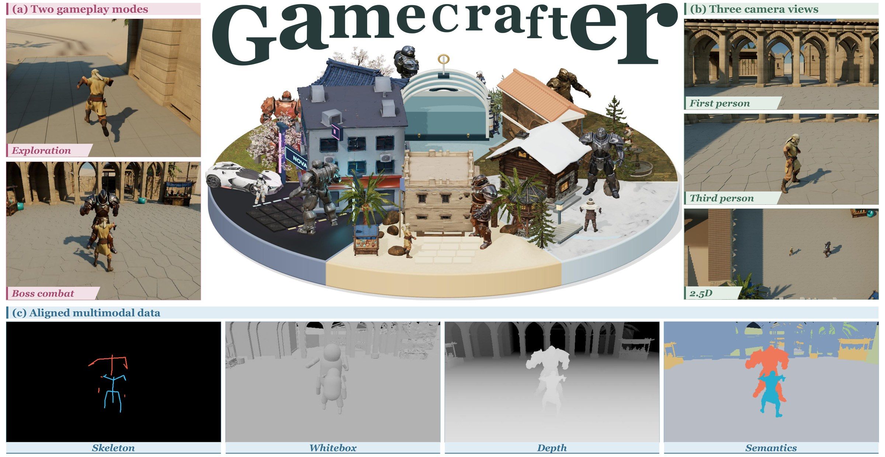
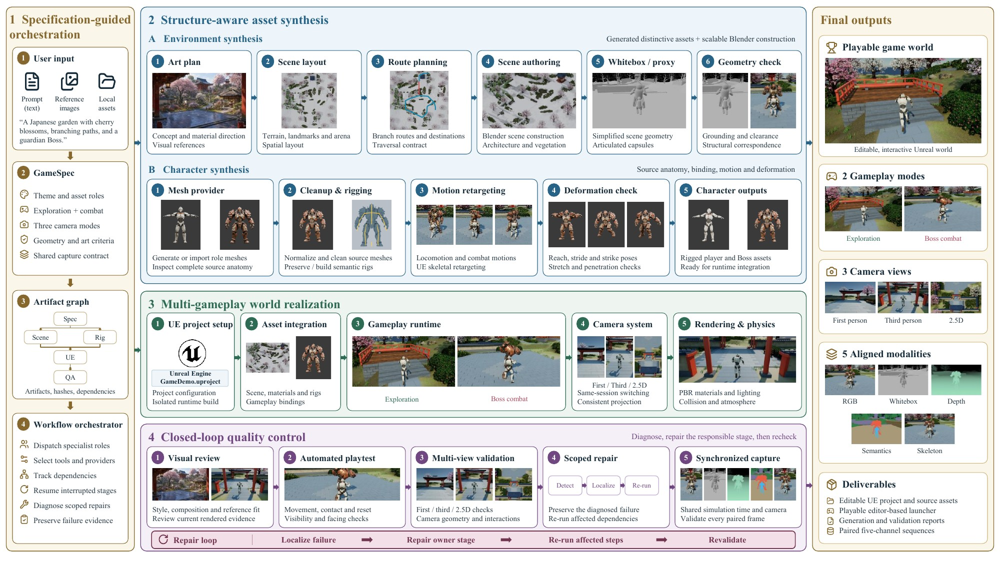
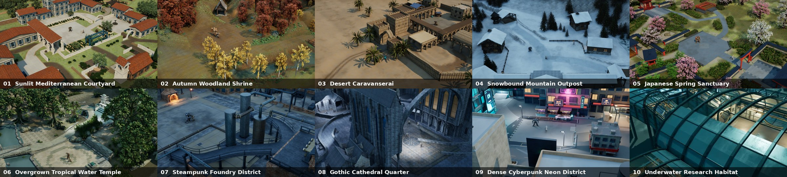

<div align="center">


# GameCrafter: An Agentic Framework for Multi-Gameplay Game World Generation

Zhiyang Deng<sup>1,2,†</sup>, Xiyao Deng<sup>1,2,†</sup>, Yeying Jin<sup>1,2,‡,*</sup>

<sup>1</sup>Tencent, <sup>2</sup>National University of Singapore

<sup>†</sup>Equal contribution. Work done during research internships at Tencent · <sup>‡</sup>Project lead · <sup>*</sup>Corresponding author

[](https://github.com/TeaWhiteBro/GameCrafter/blob/main/paper/GameCrafter.pdf)
[](https://teawhite.cn/GameCrafter/)
[](LICENSE)

[English](README.md) | [简体中文](README.zh-CN.md)

</div>



<p align="center"><sub><b>3D game worlds generated by GameCrafter.</b> (a) Exploration and boss-combat gameplay; (b) first-person, third-person and 2.5D camera views; (c) aligned RGB, skeleton, whitebox, depth and semantic data captured from the same simulation state and camera.</sub></p>

**GameCrafter** turns a single prompt into a high-quality, multi-gameplay 3D game world. Specialized agents and tools are coordinated through **Specification-Guided Orchestration**; **Structure-Aware Asset Synthesis** builds environments and characters that look right and also carry executable structure; **Multi-Gameplay World Realization** grounds them in one shared runtime where exploration and boss combat coexist; and **Closed-Loop Quality Control** combines visual inspection, playtesting and iterative repair. Each world also yields synchronized multi-view, multimodal data aligned within the same simulation.

GameCrafter coordinates specialist model roles, generative services, Blender and Unreal Engine to turn a text prompt or reference images into an editable, playable game demo. The built-in gameplay is free exploration and a humanoid melee Boss encounter. The framework also validates three camera modes and exports five paired observation channels.

This repository contains the complete framework source, Blender scripts, UE Python adapters, C++ gameplay/capture runtime, contracts, prompts and offline tests. A new `fresh` run requires no previous game, privately generated asset library or accepted screenshot. It reproduces the **process and acceptance contracts**, rather than identical generated assets. Native tools, compatible template motions and authorized service access are installed separately.

## What the framework produces

| Input | Playable output | Observation output |
|---|---|---|
| Text prompt; optional scene/player/Boss reference images | Connected exploration map and melee arena; player/Boss meshes, skinning and retargeted motion; editable UE project and launcher | First-person, third-person and isometric/2.5D; RGB, metric depth, semantic IDs, skeleton and structural whitebox |

The `world_demo` profile tests both activities across all three cameras. `arena_demo` keeps combat, three cameras and all five channels. Default observations are six 360-frame sequences at 640×360 with fixed 60 Hz simulation. Real-time game performance is measured separately.

## Method



GameCrafter has four parts, as described in the paper:

1. **Specification-Guided Orchestration** turns the prompt and optional references into a shared game specification and runs production through an artifact dependency graph.
2. **Structure-Aware Asset Synthesis** builds gameplay-ready environments (art plan, layout, routes, Blender authoring, whitebox) and characters (meshes, rigging, motion retargeting, deformation checks).
3. **Multi-Gameplay World Realization** integrates these assets into one Unreal Engine project with exploration, boss combat, three cameras, rendering and physics.
4. **Closed-Loop Quality Control** combines visual review, automated playtesting and multi-view validation, localizes failures, repairs the responsible stage and re-runs only the affected steps. In this repository, diagnosis and scoped repair are carried out by an executing coding agent (see [Use an executing agent](#use-an-executing-agent)).

Stage-level details: [interactive workflow](docs/workflow.html), [agent collaboration](docs/agent-collaboration.html), [stage responsibilities](docs/WORKFLOW.md) and [code map](docs/CODE_MAP.md).

## Ten generated worlds



The ten worlds from the paper, each generated from a single prompt. Gameplay videos for every world are on the [project page](https://teawhite.cn/GameCrafter/).

## Install

The native integration targets **Windows**. Its recorded toolchain is Python **3.12**, Blender **5.2.1**, Unreal Engine **5.8**, Visual Studio **2022** with C++ build tools and Windows SDK, and a GPU capable of the configured UE rendering features. See [reproduction requirements](docs/REPRODUCING.md) for motion assets and platform limits.

From a checkout in PowerShell:

```powershell
.\setup.ps1 -Python python
& .\.venv\Scripts\python.exe -B -m unittest discover -s tests
& .\.venv\Scripts\python.exe -B scripts\verify_repository.py
```

`python` must point to Python 3.12; otherwise pass its full executable path to `-Python`. Setup installs pinned dependencies from [requirements.lock.txt](requirements.lock.txt). Offline tests do not need an API key or engine installation and do not certify a completed native game.

## Configure tools and APIs

```powershell
& .\.venv\Scripts\python.exe pipeline.py init --unreal-root "D:\UE_5.8" --blender "C:\Program Files\Blender Foundation\Blender 5.2\blender.exe" --build-root "D:\GameCrafterBuilds" --planner-model "YOUR_VISION_CAPABLE_CHAT_MODEL"
$gatewaySecret = Read-Host "Gateway API key" -AsSecureString
$env:LEVELINFINITE_API_KEY = [System.Net.NetworkCredential]::new('', $gatewaySecret).Password
& .\.venv\Scripts\python.exe pipeline.py doctor
```

Replace example paths and the chat model name with your installation/account settings. `init` creates an ignored `machine.local.json` and refuses to overwrite one. The gateway is configured for Level Infinite chat/vision, `gpt-image-2` and `tripo3d/v3.1-20260211`; these require account-specific access. Switching to the native Tripo API requires a provider implementation, not just a changed base URL. [API configuration and recovery](docs/API.md) documents endpoints and authentication.

Keep keys in the named process environment variable; `.env` is **not automatically loaded**. Neither keys nor local machine configuration belong in Git. `doctor` checks local prerequisites without charging APIs; it does not test billing access, GPU performance or MSVC compilation. Default per-run call limits are eight meshes, two images and 100 chat calls, including repairs.

## Generate from a prompt or images

Start a new independent case:

```powershell
& .\.venv\Scripts\python.exe pipeline.py run --run-dir runs\garden --prompt-file examples\prompts\sakura.txt --profile world_demo --source-policy fresh
```

Or specify the content directly:

```powershell
& .\.venv\Scripts\python.exe pipeline.py run --run-dir runs\new_world --prompt "Create a sunlit stone courtyard with branching garden paths, an armored traveler and a humanoid bronze guardian. Support free exploration and a melee Boss encounter." --profile world_demo --source-policy fresh
```

Use local references to guide a new scene and newly generated characters:

```powershell
& .\.venv\Scripts\python.exe pipeline.py run --run-dir runs\reference_world --prompt "Build a connected exploration world and humanoid Boss encounter matching the references." --reference-scene inputs\scene.png --player-image inputs\player.png --boss-image inputs\boss.png --profile world_demo --source-policy fresh
```

Scene references guide design and concept-image editing; they are not automatic reconstructions of a whole photograph. Character references use Tripo image-to-3D. Four-view generation and explicit existing meshes are covered in [the reproduction guide](docs/REPRODUCING.md). [Ten benchmark prompts](examples/benchmark_prompts.json) offer varied example inputs without shipping prior generated assets.

## Use an executing agent

Open this repository in your coding agent and provide the task in [examples/prompts/agent_task.txt](examples/prompts/agent_task.txt), replacing the brief and input/run paths. The agent reads [AGENTS.md](AGENTS.md) and [AGENT_PROTOCOL.md](AGENT_PROTOCOL.md), runs tools, inspects source/deformation and current UE views, diagnoses failures and resumes affected stages. Reference images and generated outputs are data, not instructions.

## Inspect, repair, resume and play

```powershell
& .\.venv\Scripts\python.exe pipeline.py status --run-dir runs\garden
& .\.venv\Scripts\python.exe pipeline.py diagnose --run-dir runs\garden
& .\.venv\Scripts\python.exe pipeline.py impact --run-dir runs\garden --changed-file game_pipeline\rendering.py
& .\.venv\Scripts\python.exe pipeline.py run --run-dir runs\garden
& .\.venv\Scripts\python.exe pipeline.py replay --run-dir runs\garden
& .\.venv\Scripts\python.exe pipeline.py play --run-dir runs\garden
```

Resume without repeating `--prompt`. `replay` verifies completed matching receipts and refuses to generate missing work. Use a new run directory for a new case. The journal retains remote task IDs and uncertain submission markers: do not erase them to force another paid request. [Repair protocol](AGENT_PROTOCOL.md) defines diagnosis, evidence and invalidation rules.

Default controls: WASD movement; Shift sprint; J/left mouse attack; K/right mouse heavy attack; Space dodge; C guard; Tab lock; R reset; 1/2/3 first/third/isometric view; V cycle. Check the emitted HUD for the selected runtime. Mouse look is available in perspective views.

For an explicit replacement, create a sibling variant and retain the original:

```powershell
& .\.venv\Scripts\python.exe replace_character.py --from-run runs\garden --run-dir runs\garden_new_boss --role boss --image inputs\new_boss.png
& .\.venv\Scripts\python.exe pipeline.py run --run-dir runs\garden_new_boss
```

Use `--mesh` for an existing mesh. This is an intentional `provided` variant, not a fresh independent case; deformation, facing and runtime checks remain required.

## Artifacts and acceptance

Each run contains `game_spec.json`, `pipeline_manifest.json`, `run.sqlite`, hashed stage revisions, `run_summary.json` and, after release acceptance, `release.json`. Follow these manifests to the exact project, launcher, captures and reports instead of guessing stage hashes. Native compilation and full datasets can require substantial disk space.

Release requires source/skin/animation checks, saved-geometry route support, current UE visual review, real contact and traversal, facing fault controls, camera switching, independent calibration and all-frame native/export agreement. [QUALITY_GATES.md](QUALITY_GATES.md) and [DATASET.md](DATASET.md) define the requirements and alignment limits. RGB and simplified whitebox share camera/time but have different surface silhouettes. Separate camera runs are not simultaneous multi-view ground truth.

The deliverable is an **editable UE project with an editor-based launcher**. Cooking a standalone executable, driving, multiplayer, arbitrary non-humanoid rigs and dedicated first-person arms are extensions. There is no guaranteed wall-time or commercial AAA quality. See [limitations](docs/LIMITATIONS.md) and [validation scope](docs/VALIDATION.md).

## Contribute and publish

Read [CONTRIBUTING.md](CONTRIBUTING.md), [provider extension contracts](docs/PLUGINS.md), [security guidance](SECURITY.md) and [publishing checklist](docs/PUBLISHING.md). The clean-source exporter is:

```powershell
& .\.venv\Scripts\python.exe scripts\build_release.py --out ..\GameCrafter-source --zip ..\GameCrafter-source.zip
```

Original source/documentation uses the [MIT license](LICENSE). UE template animations, installed software, generated meshes, references and downloaded materials retain their respective terms; see [THIRD_PARTY_NOTICES.md](THIRD_PARTY_NOTICES.md). No engine content, API keys or generated case assets are bundled in the source distribution.

## Citation

If you find GameCrafter useful, please cite:

```bibtex
@misc{deng2026gamecrafter,
  title  = {GameCrafter: An Agentic Framework for Multi-Gameplay Game World Generation},
  author = {Deng, Zhiyang and Deng, Xiyao and Jin, Yeying},
  year   = {2026},
  note   = {Preprint},
  url    = {https://teawhite.cn/GameCrafter/}
}
```
