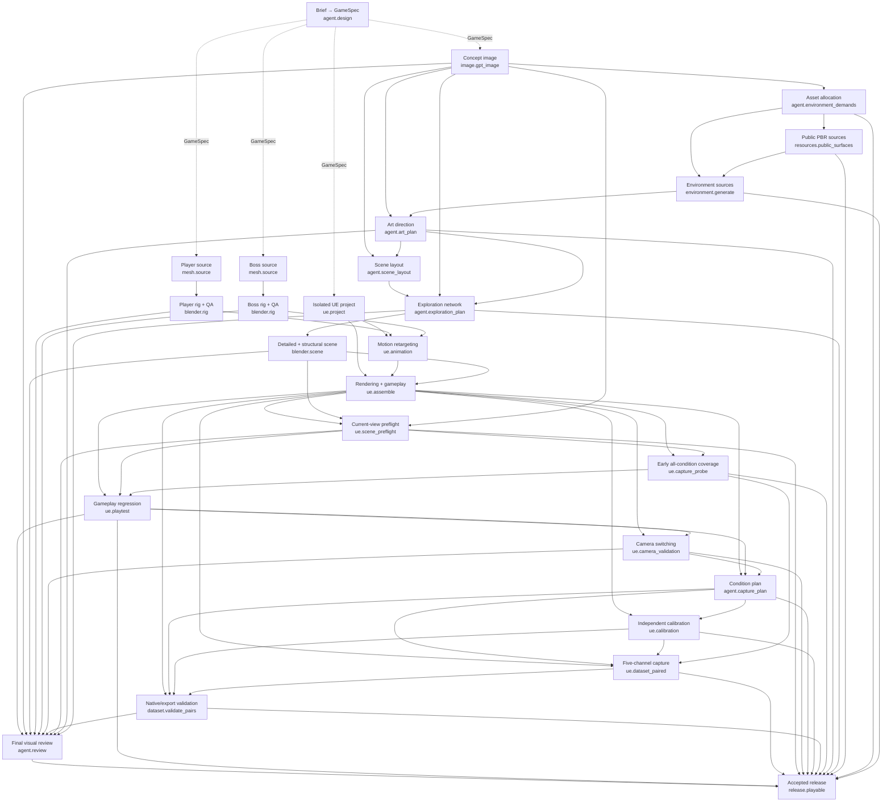

# Exact stage dependencies

Generated from `workflow_graph.json`. Solid edges are declared production dependencies. Dashed bootstrap edges supply the run specification and are not production-DAG edges.

Prerequisite machine checks and executing-agent replay / launch observation are outside this DAG.
